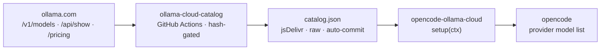

# @srnoob2570/opencode-ollama-cloud

[](https://www.npmjs.com/package/@srnoob2570/opencode-ollama-cloud)
[](https://github.com/srnoob2570/ollama-cloud-catalog/actions)
[](LICENSE)

[Read in English →](README.md)

Plugin de [opencode](https://opencode.ai) 2.x que le da al proveedor **Ollama Cloud** una lista de modelos siempre actualizada, tomada en vivo de `https://ollama.com/v1/models`, con la tarifa oficial adjunta a cada modelo.

models.dev (la fuente de modelos de opencode) se actualiza manualmente por PR y se queda desactualizado. Este plugin consume un catálogo estático mantenido por GitHub Actions, así que los modelos nuevos aparecen sin esperar a nadie.

> [!NOTE]
> **Transparencia:** este plugin y esta documentación fueron generados y son mantenidos con asistencia de IA ([opencode](https://opencode.ai)). Revisa el código antes de confiar en él para algo sensible.

## Requisitos

- opencode 2.x. Este plugin solo trae la entrada de opencode 2.x (`{ id, setup }`); opencode 1.x ya no está soportado.

## Inicio rápido

```bash
opencode plugin add @srnoob2570/opencode-ollama-cloud
```

`opencode plugin add` instala el paquete y lo registra en tu config. Para actualizar después usa `opencode plugin update` (`opencode plugin check` informa qué está desactualizado).

Reinicia opencode (o recarga su configuración) y verifica la lista de modelos:

```bash
opencode reload                       # recarga config y plugins (vuelve a ejecutar el setup del catálogo)
opencode models | grep '^ollama-cloud/'
```

Deberías ver la lista live completa (ej. `ollama-cloud/glm-5.3-flash`), incluyendo modelos que models.dev aún no tiene.


> Asume que ya configuraste tu API key de ollama.com (`opencode auth login` → `ollama-cloud`). Si el proveedor ya estaba registrado, el plugin solo refresca su lista de modelos.

## Cómo funciona



**Upstream** ([srnoob2570/ollama-cloud-catalog](https://github.com/srnoob2570/ollama-cloud-catalog)): GitHub Actions construyen y publican `catalog.json` — un documento con la forma de models.dev más la extensión `x_ollama`. El build está compuertizado por el hash de `/v1/models` (un cambio en `{id, created}` dispara la re-extracción completa), las specs vienen de `/api/show` de Ollama y la rate card se parsea con un LLM hacia el bloque `cost` de cada entrada. Fail-loud por contrato: un scrape que falla aborta en vez de publicar un catálogo degradado.

**Plugin** (`plugin/index.ts`): `setup(ctx)` carga el catálogo y registra `ctx.provider.transform`. En cada llamada al transform, el set de modelos del proveedor se reemplaza por los modelos del catálogo, con la tarifa oficial en cada registro. La cascada de fuentes del catálogo es:

1. Catálogo remoto (jsDelivr → raw.githubusercontent.com)
2. Cache local en `~/.cache/opencode-ollama-cloud/catalog.json`
3. Sin transform — el host conserva sus propios modelos de models.dev

Registrar un `provider.transform` **toma propiedad** de la lista de modelos del proveedor: una vez registrado el transform del plugin, opencode deja de mezclar las entradas `ollama-cloud` de models.dev. El plugin solo registra el transform después de que el catálogo carga con al menos un modelo — si el catálogo falla, el fallback de models.dev sigue vivo.

## Opciones

```json
{
  "plugin": [
    [
      "@srnoob2570/opencode-ollama-cloud",
      { "catalogUrl": "https://my-cdn/catalog.json" }
    ]
  ]
}
```

- `catalogUrl`: URL alternativa del catálogo (se intenta primero).
- `timeoutMs`: timeout por fetch (default `5000`).
- `pricing`: `"on"` (default) u `"off"`. Controla si el contador de coste de la sesión de opencode muestra la tarifa oficial de Ollama Cloud. `pricing: "reference"` (el valor opt-in viejo) sigue funcionando y significa `"on"`.

```json
{
  "plugin": [["@srnoob2570/opencode-ollama-cloud", { "pricing": "off" }]]
}
```

El catálogo trae la tarifa oficial de Ollama Cloud por modelo: precios de input, input cacheado y output en USD por 1M de tokens, tomados de la [rate card](https://ollama.com/pricing) pública de Ollama hacia el bloque `cost` de cada entrada (tarifas off-peak; los recargos peak quedan bajo `x_ollama.peak_cost`). Eso es lo que tus créditos pagan realmente por token, así que el contador de coste de opencode lo muestra por defecto (`pricing: "off"` lo apaga). Los modelos sin tarifa quedan en $0.

Las tarifas las refresca el workflow programado del repo del catálogo (semanal, más manual). Si la rate card y el catálogo no coinciden (un modelo nuevo o retirado), la actualización aborta con un reporte y no escribe nada.

## Desarrollo

El catálogo y su updater viven en [srnoob2570/ollama-cloud-catalog](https://github.com/srnoob2570/ollama-cloud-catalog). Este repo es solo el consumidor:

```bash
bun install
bun test
bun run typecheck
```

## Changelog

Cada versión tiene su entrada en [CHANGELOG.md](CHANGELOG.md) y su propio [GitHub release](https://github.com/srnoob2570/opencode-ollama-cloud/releases). Las ramas de release viven bajo `release/v*`.

## Licencia

MIT
