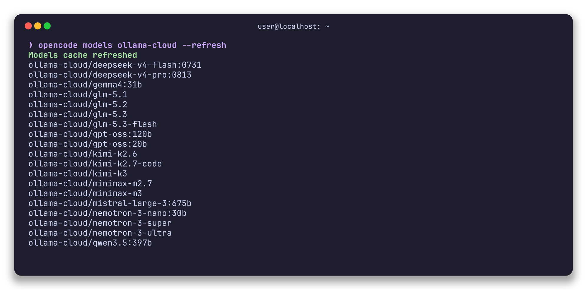
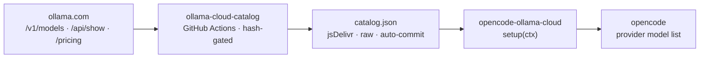

# @srnoob2570/opencode-ollama-cloud

[](https://www.npmjs.com/package/@srnoob2570/opencode-ollama-cloud)
[](LICENSE)

[Leer en español →](README.es.md)

[opencode](https://opencode.ai) 2.x plugin that gives the **Ollama Cloud** provider an always-up-to-date model list, sourced live from `https://ollama.com/v1/models`, with the official rate attached to each model.

models.dev (opencode's model source) is updated manually via PRs and goes stale. This plugin consumes a static catalog maintained by GitHub Actions, so new models appear without waiting for anyone.

> [!NOTE]
> **Transparency:** this plugin and this documentation were generated and are maintained with AI assistance ([opencode](https://opencode.ai)). Review the code before trusting it with anything sensitive.

## Requirements

- opencode 2.x. This plugin only ships the opencode 2.x entry (`{ id, setup }`); opencode 1.x is no longer supported.

## Quick start

```bash
opencode plugin add @srnoob2570/opencode-ollama-cloud
```

`opencode plugin add` installs the package and registers it in your config. To upgrade later use `opencode plugin update` (`opencode plugin check` reports what is outdated).

Restart opencode (or reload its configuration) and check the model list:

```bash
opencode reload                       # reload config and plugins (re-runs the catalog setup)
opencode models | grep '^ollama-cloud/'
```

You should see the full live list (e.g. `ollama-cloud/glm-5.3-flash`), including models models.dev doesn't have yet.



> Assumes you already configured your ollama.com API key (`opencode auth login` → `ollama-cloud`). If the provider was already registered, the plugin just refreshes its model list.

## How it works



**Upstream** ([srnoob2570/ollama-cloud-catalog](https://github.com/srnoob2570/ollama-cloud-catalog)): GitHub Actions build and publish `catalog.json` — a models.dev-shaped document with an `x_ollama` extension. The build is hash-gated on `/v1/models` (a change in `{id, created}` is what triggers a full re-extraction), specs come from Ollama's `/api/show`, and the rate card is parsed with an LLM into each entry's `cost` block. Fail-loud by contract: a scrape failure aborts instead of publishing a degraded catalog.

**Plugin** (`plugin/index.ts`): `setup(ctx)` loads the catalog and registers `ctx.provider.transform`. On every transform call the provider's model set is replaced with the catalog models, with the official rate in each record. The catalog source cascade is:

1. Remote catalog (jsDelivr → raw.githubusercontent.com)
2. Local cache at `~/.cache/opencode-ollama-cloud/catalog.json`
3. No transform — the host keeps its own models.dev entries

Registering a `provider.transform` **takes ownership** of the provider's model list: once the plugin's transform is registered, opencode stops merging models.dev's `ollama-cloud` entries. The plugin only registers the transform after the catalog loads with at least one model — on catalog failure the models.dev fallback stays alive.

## Options

```json
{
  "plugin": [
    [
      "@srnoob2570/opencode-ollama-cloud",
      { "catalogUrl": "https://my-cdn/catalog.json" }
    ]
  ]
}
```

- `catalogUrl`: alternative catalog URL (tried first).
- `timeoutMs`: per-fetch timeout (default `5000`).
- `pricing`: `"on"` (default) or `"off"`. Controls whether opencode's session cost counter shows the official Ollama Cloud rate. `pricing: "reference"` (the old opt-in value) still works and means `"on"`.

```json
{
  "plugin": [["@srnoob2570/opencode-ollama-cloud", { "pricing": "off" }]]
}
```

The catalog ships the official Ollama Cloud rate per model: input, cached-input and output prices in USD per 1M tokens, taken from Ollama's public [rate card](https://ollama.com/pricing) into each catalog entry's `cost` block (off-peak rates; peak surcharges stay under `x_ollama.peak_cost`). That is what your credits actually pay per token, so opencode's cost counter shows it by default (`pricing: "off"` turns it off). Models without a rate stay at $0.

Rates are refreshed by the catalog repo's scheduled workflow (weekly, plus manual). If the rate card and the catalog disagree (a new or retired model), the update aborts with a report and writes nothing.

## Development

The catalog and its updater live in [srnoob2570/ollama-cloud-catalog](https://github.com/srnoob2570/ollama-cloud-catalog). This repo is only the consumer:

```bash
bun install
bun test
bun run typecheck
```

## Changelog

Every version gets an entry in [CHANGELOG.md](CHANGELOG.md) and its own [GitHub release](https://github.com/srnoob2570/opencode-ollama-cloud/releases). Release branches live under `release/v*`.

## License

MIT
